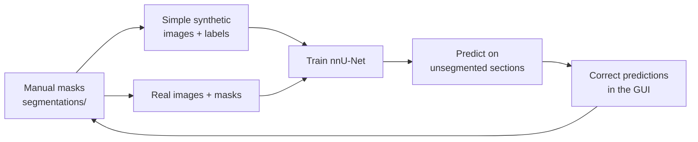

# BBDB Cortex Segmentation

A brainhack project to segment the **cerebral cortex** by hand in brain
sections from many mammal species. The sections come from the **Brain
Biodiversity Bank** (BBDB). The project includes a small desktop tool to make
the work quick. Each section opens with a starting mask from an **Otsu-based
intensity range**. You can move the minimum and maximum threshold sliders and
then fix the mask with a brush, paint bucket and undo. You can also create
several rectangular ROIs and give each one its own threshold range. The
finished masks are saved as 0/1 PNGs in this repository, and every operation is
appended to a `.ops.jsonl` log next to the mask, so masks can be committed and
shared.

The work is split into one CSV per **specimen and stain** (for example
`csv/lion_nissl.csv`). Participants can each take one or more CSVs. A section
is **done** when its manual **Segmented** status is true. If no status has been
written yet, an existing PNG is treated as segmented. The **Queue** menu can
show **not segmented**, **segmented**, or **all** (default: all).

> **TL;DR:** for each section, paint the **cerebral cortex** (the grey matter
> ribbon on the surface of the cerebral hemispheres) and nothing else. See
> [What to segment](#what-to-segment-the-cerebral-cortex).
>
> **Data:** download the images from
> [Google Drive](https://drive.google.com/drive/folders/1xKnObX2FhnvCv1kEoc2XopjUlRqNYZTq?usp=sharing)
> and unzip them **inside this repository folder**. See
> [Step 2](#step-2-get-the-image-data).

---

## Contents

- [Why this project?](#why-this-project)
- [What to segment: the cerebral cortex](#what-to-segment-the-cerebral-cortex)
- [Background: the two types of sections](#background-the-two-types-of-sections)
- [Features](#features)
- [Repository layout](#repository-layout)
- [Requirements](#requirements)
- [Installation](#installation)
  - [Recommended graphical tools](#recommended-graphical-tools)
  - [Step 1: Get the code](#step-1-get-the-code)
  - [Step 2: Get the image data](#step-2-get-the-image-data)
  - [Step 3: Install Python and the dependencies](#step-3-install-python-and-the-dependencies)
- [Running the GUI](#running-the-gui)
- [Using the GUI](#using-the-gui)
  - [Window layout](#window-layout)
  - [Threshold](#threshold)
  - [Keyboard shortcuts](#keyboard-shortcuts)
  - [Mouse](#mouse)
  - [Contrast and opacity](#contrast-and-opacity)
  - [Typical workflow](#typical-workflow)
- [Outputs](#outputs)
- [Submitting your segmentations](#submitting-your-segmentations)
- [Stretch goal: bootstrap with synthetic data and nnU-Net](#stretch-goal-bootstrap-with-synthetic-data-and-nnu-net)
- [Regenerating the CSVs](#regenerating-the-csvs)
- [Command-line options](#command-line-options)
- [Troubleshooting](#troubleshooting)
- [How it works](#how-it-works)
- [License](#license)

---

## Why this project?

To study cortical microstructure in 2D post-mortem brain sections, you first
need an accurate cortical segmentation. That is hard to automate. Contrast
varies a lot between stains, imaging modalities and species, and the cortex has
layers that change in intensity.

We have developed **CAPS** (cortical all-purpose segmentation). It is a U-Net
that we trained **only on synthetic 2D sections**. To make them, we sliced 3D
label volumes from the human, chimpanzee, macaque and marmoset, deformed them
randomly, and gave each region random intensities and imaging artefacts. The
multi-species model works well on real autoradiography, histology and ex vivo
MRI. It also works on species it never saw during training.

So far, though, our out-of-sample test was very small: **one** histological
section each from the sea lion, cat, pig and owl monkey. The Brain Biodiversity
Bank has thousands of sections from dozens of species, but they don't have cortical labels. Therefore, we need your help to manully segmnt more of these sections. Manually segmented sections are shared openly on Zenodo and we can add you as a contributor.

If time permits and we have enough sections, we can also train a
  model on what has been segmented so far, use its predictions as starting
  masks for the rest, and repeat. See
  [Stretch goal: bootstrap with synthetic data and nnU-Net](#stretch-goal-bootstrap-with-synthetic-data-and-nnu-net).


The segmentations you create here will be used to:

- **A) test generalisation.** We will measure how well CAPS segments the cortex
  in species and stains that were not used to train it.
- **B) make more training data.** We will generate new 2D synthetic training
  images from the 2D segmentations themselves. That expands the variety of
  anatomy the model learns from, beyond the four species we have 3D atlases for.

Every section you segment adds to all of these.  The sections come from the Welker, Johnson &
Noe Comparative Mammalian Brain Collection
(<https://brains.anatomy.msu.edu>).

---

## What to segment: the cerebral cortex

Paint **only the cerebral cortex**: the ribbon of grey matter that forms the
outer surface of the cerebral hemispheres and follows every gyrus and sulcus.
The mask should be `1` on the cortex and `0` everywhere else.

| Include (mask = 1)                                  | Exclude (mask = 0)                                          |
| --------------------------------------------------- | ----------------------------------------------------------- |
| Cerebral cortex grey matter, from the pial surface down to the grey/white boundary | White matter beneath the cortex                             |
| Cortex deep inside sulci, including where two banks touch | **Cerebellum**, even though it is also a folded cortex      |
|                                                     | Brainstem, thalamus, basal ganglia and other deep nuclei    |
|                                                     | Background, ventricles, tears/holes, debris                 |
|                                                     | Text, specimen numbers, scale bars and logos                |

The examples below come from existing manual annotations of BBDB Nissl
sections. The left column shows the original section and the right column the
cortex label in red. Notice what is left out:

- the cerebellum in the sea lion (its folia stain very dark, but they are not
  cerebral cortex);
- the cerebellum and brainstem in the mongoose, where only the thin cerebral
  cortex at the top is labelled;
- the brainstem in every example.


Tips:

- Draw the grey/white boundary where the dark grey matter meets the paler white
  matter (in Nissl sections). If you are unsure, lean towards following the
  visible contrast edge.
- Where the two banks of a sulcus touch, keep them in the mask, but leave any
  visible gap of background between them unpainted.
- It's fine to be approximate at a pixel level. Missing a whole gyrus or
  including the cerebellum matters much more.
- If a section has **no cerebral cortex** (e.g. only cerebellum and brainstem),
  press **Clear** and then **Enter**. That saves an empty mask so the section
  counts as done.
- If a section is unusable (badly torn, out of focus, or not a brain section),
  save an empty mask and mention the section in your pull request.

---

## Background: the two types of sections

The Brain Biodiversity Bank contains two different types of sections, and they
look quite different from each other. Understanding why matters for choosing
the right processing steps.

**Nissl** sections are stained to show the density of neuron cell bodies. In
these sections, the cortical grey matter appears **dark**.

**"Myelin"** sections are labelled by the Bank as "myelin", but that name is a
little misleading. Myelin itself is the fatty substance that wraps around
neuronal axons. It insulates them and keeps the electrical signal (the action
potential) from leaking, much like the plastic coating on a wire. The name
refers to what is being visualised, not to the stain. The stain actually used
is probably Gallyas, though the Bank chose to organise the data by "myelin"
rather than by stain name. In these sections, the cortical grey matter appears
**bright**, the opposite of Nissl. The densely myelinated white matter appears
very dark.


What this means for the threshold tool:

- **Nissl:** the cortex is dark. The GUI starts with a range such as
  `0–Otsu`, which selects the dark tissue, and **Invert** off. To keep only the
  darker cortex, lower **Threshold max**. Then erase the cerebellum, brainstem
  and any remaining white matter, and use **Fill** to close small holes.
- **Myelin:** the cortex is the pale band *between* the dark white matter and
  the white background. Set **Threshold min** above the dark white matter and
  **Threshold max** below the white background to select that pale band. If the
  band looks too narrow, widen the range. **Invert** selects everything outside
  the range instead. Raising **Contrast min** can make the pale cortex easier
  to see.
- The `owl_monkey_nissl+myelin` and `red_kangaroo_nissl+myelin` groups mix both
  kinds, so check which kind each section is before you start.

---

## Features

- The **Queue** menu switches between **not segmented**, **segmented**, and
  **all** sections. **Segmented** is a manual checkbox, so a saved PNG does not
  force the section to stay marked done.
- **Segmented** auto-checks when a PNG is written. **Stop auto confirm** is a
  per-image switch that prevents that automatic check and writes a
  `stop autolog` tag to the operation log.
- **Threshold min** and **Threshold max** build the mask from the image.
  Pixels inside the range `min <= value <= max` become `1`; pixels outside
  become `0`. The initial range is chosen from the image's **Otsu threshold**
  and whether the border is dark or bright.
- **Invert** selects pixels *outside* the range instead. It starts off; the
  initial range already selects the non-background side.
- **Shift+left-drag** creates a rectangular selection (ROI);
  **Shift+right-drag** draws a freehand lasso ROI. You can create several of
  either kind. **Shift+click** inside an ROI activates it; **Shift+click**
  outside clears the active ROI; **Backspace** / **Delete** removes the active
  ROI. Each ROI remembers its own threshold range and Invert setting. With an
  active ROI, the threshold sliders only rewrite pixels inside that ROI; the
  rest of the mask is preserved.
- You can **draw** and **erase** with the brush, **clear** the mask, or
  **erode** / **dilate** it by one pixel. Brush size can be changed with the
  wheel, `[` / `]`, the Brush ± buttons, or by typing a pixel value directly
  into the toolbar box (2–120 px).
- Press **p** for the **colour picker**: scribble over an area (right-drag to
  **exclude**, left-drag to **include**) and every continuous block of that
  gray level touched by the scribble changes at once, as one solid piece (holes
  up to 400 px inside a block, such as vessels or dark streaks, go with it), e.g.
  scribble along the pale white matter of a Nissl section to drop all of it. The gray range is taken from the
  scribbled pixels (centred on their dominant level, so straying over an edge
  is fine) on a slightly smoothed image, and thin bridges are cut so the pale
  cortical layers, which in Nissl have nearly the same gray level as white
  matter, stay untouched. An active selection limits the change to it.
  **Rejected blocks turn transparent dark blue** and stay blue: blue pixels are
  never cortex, so the threshold sliders, the brush, the fill bucket, Clean and
  include-picks all leave them out, just like background. A handy workflow:
  right-drag the white matter blue, then lasso the section and move the
  threshold sliders; only non-blue tissue turns red. Ctrl+Z undoes a pick
  (blue included); **Clear blue** removes the whole blue layer. The blue layer
  is kept per section while the GUI is open; it is not saved to disk.
  The status bar shows the gray range used; each pick is one undo step.
- Press **L** for **brush selection**: left-drag paints a blue region. On
  release it becomes a blue outline, then a normal ROI. Threshold changes then
  apply only inside that brush ROI. Several strokes extend the same brush ROI
  instead of creating a pile of separate selections; right-drag erases part of
  the active brush ROI.
- A **paint bucket** fills a connected region of the mask in one click, for
  example a hole inside the tissue. Right-click with the bucket empties a
  region instead.
- **Undo** (Ctrl+Z or `u`) and **Redo** (Ctrl+Y, Ctrl+Shift+Z or `y`) cover
  mask changes *and* selection changes (creating, extending, brush-erasing or
  deleting a rectangle, lasso or brush selection), up to 30 steps per section.
  A new edit after an undo clears the redo history.
- You can **rotate** the view in 90° steps and **flip** it horizontally or
  vertically. The choice is recorded in the CSV. The saved mask always stays
  aligned with the original image.
- You can **zoom** with the mouse wheel, `+` / `-`, and **pan** by dragging
  with the middle mouse button or Ctrl+left. `0` fits the image to the window
  again. Zooming and panning change only the view, never the saved mask.
- **Exclude background** (on by default): the slide background level is
  estimated from the image border, and background pixels (plus a 1-px margin
  for the blurry tissue rim) are never selected, whether by the threshold
  sliders, brush strokes or the fill bucket. White, grey or dark backgrounds
  all work. Colour is used too: a pixel only counts as background if it also
  has the slide's colour, so the faint cream edge of myelin-stained cortex
  (almost as bright as a white slide, but tinted) stays selectable.
- **Clean (k)** tidies the mask in one undoable step. It removes background
  pixels, snaps the boundary onto the strongest nearby image edge (a 3-px band,
  marker-controlled watershed: the outline can move up to that edge but never
  across it) and drops islands under 30 px. Clean always works on the whole
  mask, whether or not a selection is active. **Your hand edits win:** while
  **Keep brush strokes** is ticked (default), pixels you painted with the brush
  or fill bucket are never removed by Clean (unless they are background or
  legend); untick it to let Clean tidy roughly painted areas too. Pixels you
  erased by hand are never added back. Check the result, then
  Ctrl+Z if you don't like it. Install `scikit-image` for exact edge placement
  (otherwise a scipy fallback is used).
- **Exclude legend** (on by default): slide labels ("63-310", "#1650"), the
  scale bar and the credit line are detected automatically (small separate
  blobs in the top/bottom 20 % of the slide, not touching the section) and are
  never selected.
- **Smooth strokes** (on by default): brush strokes are smoothed with a
  1-euro filter, which smooths slow, careful movements (where jitter shows) but
  barely filters fast ones, so the line does not trail the pointer; it
  finishes exactly where you release. Lasso outlines are rounded before
  becoming an ROI.
- **Snap brush to edges** (on by default): when you release a brush stroke,
  it is snapped to the image with a local marker-controlled watershed. The
  stroke's centre line and the existing mask count as "cortex", a 3-px ring
  just outside the stroke counts as "not cortex", and the boundary settles on
  the strongest edge in between. Strokes therefore stop at a clear tissue edge
  instead of spilling over it, while in uniform tissue the whole stroke is
  kept (edges weaker than 10 gray levels/px are ignored). Erasing works the
  same way: the eraser stops at a strong edge and leaves the cortex beyond it.
  Background and legend are never painted. While you drag you see the raw
  stroke; the snapped result appears on release.
- While you drag, the mask overlay itself updates under the brush (painting
  adds red, erasing removes it). Only the small area around the newest stroke
  segment is redrawn, so painting stays responsive at any zoom.
- **Overlay opacity** and **contrast** sliders change only what you see on
  screen.
- Every mask-changing operation and every ROI action is appended to
  `<section>.ops.jsonl` immediately. The PNG is written only when you press
  **Enter**, **s**, **q**, or switch to another section.

### UNet starting masks

The packaged 504 model can propose the cortex before you edit:

- **Use model** starts a persistent nnU-Net worker from `.venv-nnunet`. The
  first start loads the checkpoint (several seconds); later sections only pay
  for inference.
- Opening a section that has **no saved mask** runs the model automatically
  (or reuses its cached prediction) and paints it **yellow**. Where the status
  line normally says `○ not segmented`, it now says `○ predicted` in yellow.
  The first manual edit turns the mask back to red and restores
  `○ not segmented`.
- **Run UNet** re-runs the model on the current section at any time and shows
  the prediction in yellow on top of the manual mask.
- **Use prediction** accepts that prediction as the working mask: the overlay
  turns red (it is no longer a draft) while the status keeps saying
  `○ predicted`; it is one undo step. If a mask is already saved, the GUI asks
  first. The button then changes to **Save prediction**, which writes the PNG
  immediately, drops the predicted state and marks the section **Segmented**.
  Editing before saving restores **Use prediction**, so the model result can be
  re-applied.
- **Load prediction** shows the cached prediction for the current section
  without starting the model (works even when **Use model** is unticked). On a
  section with no saved mask it becomes the yellow starting mask; on a saved
  section it is only a preview until **Use prediction**.
- **Clear prediction** deletes this section's cached PNG under
  `segmentations/UNet_output/`. It never touches the manual mask; a mask
  already accepted from that prediction stays as a normal edited mask.
- Predictions are cached under `segmentations/UNet_output/<group>/<base>.png`.
  They are never written into the manual tree until you accept them.
- This needs the extracted `bbdb_model_504/` package and the `.venv-nnunet`
  environment (see `nnunet_tools/README.md`). Without them the checkbox reports
  the missing path and the rest of the GUI keeps working.

---

## Repository layout

```
bbdb_seg/                       # Python package (implementation)
  app.py                        # SegmentGui composition + CLI
  __main__.py                   # python -m bbdb_seg
  ui.py                         # Tk widget construction
  session.py                    # image/mask loading, saving and queue I/O
  status.py                     # manual segmented status and stop autolog
  unet.py                       # UNet worker lifecycle, prediction cache and overwrite
  clean.py                      # background detection, edge snapping, island removal (pure)
  cleaning.py                   # Exclude background/legend, Clean (k), edge-aware brush glue, hand-edit memory
  history.py                    # undo/redo for mask and selection edits
  smoothing.py                  # brush stabiliser and lasso (Chaikin) smoothing
  work_queue.py                 # CSV selection and work-queue refresh
  threshold.py                  # threshold range, Invert, slider coalescing
  brush_select.py               # brush-shaped ROI gesture and blue transition
  selection.py                  # rectangular ROI selection and drawing
  lasso.py                      # freehand lasso ROI gesture
  painting.py                   # brush/fill/undo/morphology and transforms
  tools.py                      # brush size, tool mode and cursor
  rendering.py                  # canvas rendering, zoom and pan
  settings.py                   # shared defaults and constants
  paths.py                      # data-root discovery and path helpers
  datasets.py                   # group-CSV loading and queue helpers
  image_ops.py                  # Otsu, threshold mask, contrast and mask diff
  roi.py                        # ROI model and base/display mapping
  view_math.py                  # fit/zoom/pan calculations
  ops_log.py                    # append-only .ops.jsonl writer
  transforms.py                 # flip/rotation helpers
  make_csvs.py                  # builds csv/*.csv from sect_info.csv + images
segment_gui.py                  # compatibility entry point -> bbdb_seg.app
make_segmentation_csvs.py       # compatibility entry point -> bbdb_seg.make_csvs
sect_info.csv                   # specimen / species / stain / section metadata for every image
requirements.txt                # Python dependencies
nnunet_tools/                   # training/export scripts and predict_worker.py (own .venv-nnunet)
tests/                          # unittest suite
csv/                            # one CSV per specimen_stain  (the GUI input; tracked in git)
segmentations/                  # saved masks and .ops.jsonl logs, one folder per specimen_stain (git-ignored; shared separately)
  UNet_output/                  # cached model predictions, <group>/<base>.png (never manual masks)
docs/                           # figures used in this README
```

The source images are **not** in this repository because they are too large.
Download them from
[Google Drive](https://drive.google.com/drive/folders/1xKnObX2FhnvCv1kEoc2XopjUlRqNYZTq?usp=sharing)
and unzip them inside the repository folder. See
[Step 2](#step-2-get-the-image-data).

---

## Requirements

- **Python 3.8 or newer**
- Python packages from `requirements.txt`: `numpy`, `pandas`, `Pillow`, `scipy`
- **Tkinter**, Python's built-in GUI toolkit. The official Python installers
  for Windows and macOS include it. On Linux you install it separately as
  `python3-tk`.

The GUI opens a window, so you need a graphical desktop.

---

## Installation

### Recommended graphical tools

| Purpose | Tool | Notes |
| ------- | ---- | ----- |
| Git with a GUI | **[GitHub Desktop](https://desktop.github.com/)** | Windows & macOS. Use it to clone the repo and later to **commit and push** your segmentations. |
| Python with a GUI | **[Anaconda](https://www.anaconda.com/download)** | Windows, macOS & Linux. Comes with **Anaconda Prompt**, a terminal that is ready to use. |
| Beginner Python editor | **[Thonny](https://thonny.org/)** | Comes with its own Python and has a simple **Run** button. |

### Step 1: Get the code

Because you will submit your masks back to the repository, **clone it with git**
rather than downloading a ZIP:

- **GitHub Desktop:** click **Clone**, paste the repository URL, and choose a
  local folder.
- **Command line:**
  ```bash
  git clone https://github.com/<your-org>/<your-repo>.git
  cd <your-repo>
  ```

### Step 2: Get the image data

The images are **not** in this repository. Download them from Google Drive:

**Data download: <https://drive.google.com/drive/folders/1xKnObX2FhnvCv1kEoc2XopjUlRqNYZTq?usp=sharing>**

1. Open the link and click **Download** (top right, or right-click the
   `brain_biodiversity_bank` folder → **Download**). Google Drive zips the
   folder first, which takes a minute. You get a file of about **1 GB** named
   something like `brain_biodiversity_bank-20261017T220021Z-1-001.zip`.
2. **Move the zip into the repository folder** (the folder that contains
   `segment_gui.py`) and unzip it there. On Windows, right-click → **Extract
   All…**. On macOS, double-click. On Linux, run `unzip brain_biodiversity_bank-*.zip`.
3. Check that the result looks like this:

```
bbdb_segmentation/                          # this repository
  segment_gui.py
  csv/
  ...
  brain_biodiversity_bank-XXXXXXXX/         # created by unzipping (the name may vary)
    brain_biodiversity_bank/
      v.1/
        sections/
          lion_nissl/1000lion6279.jpg
          ...
```

The GUI then finds the data automatically. Things to know:

- The folder is listed in `.gitignore`, so the images are **never committed**.
  You can delete the zip after extracting.
- The extra `brain_biodiversity_bank-XXXXXXXX/` wrapper folder is optional.
  `bbdb_segmentation/brain_biodiversity_bank/v.1/sections/...` works too.
- Putting the data folder **next to** the repository (in the same parent
  folder) also works.
- If Google Drive splits the download into several zips (`…-1-001.zip`,
  `…-1-002.zip`, …), extract them all so that their contents end up in the
  **same** `brain_biodiversity_bank/v.1/sections/` folder.

If you keep the data somewhere else, pass
`--data-root /path/to/brain_biodiversity_bank` (the folder that contains
`v.1/`). Or just choose that folder when the GUI asks for it.

### Step 3: Install Python and the dependencies

Open a terminal **in the repository folder**, then run the commands for your
operating system.

**Windows.** Install Python from <https://www.python.org/downloads/windows/>
and keep **"tcl/tk and IDLE"** checked during installation. Then run:

```powershell
py -3 -m venv .venv
.venv\Scripts\activate
python -m pip install --upgrade pip
pip install -r requirements.txt
```

**macOS.** Install Python from <https://www.python.org/downloads/macos/>. If you
use Homebrew instead, also run `brew install python-tk`. Then run:

```bash
python3 -m venv .venv
source .venv/bin/activate
python -m pip install --upgrade pip
pip install -r requirements.txt
```

**Linux (Ubuntu / Debian):**

```bash
sudo apt install -y python3 python3-venv python3-pip python3-tk
python3 -m venv .venv
source .venv/bin/activate
python -m pip install --upgrade pip
pip install -r requirements.txt
```

The virtual environment (`.venv`) is optional. If you skip it, you can
double-click `segment_gui.py` on Windows to start the GUI.

---

## Running the GUI

```bash
# Linux/macOS
python segment_gui.py csv/lion_nissl.csv

# Windows
python segment_gui.py csv\lion_nissl.csv
```

If you run `python segment_gui.py` without a CSV, a file picker opens so you can
choose one. The package can also be launched directly with
`python -m bbdb_seg`.

The queue opens with **all** sections by default. Change **Queue** in the
display controls to **not segmented**, **segmented**, or **all**; the queue is
rebuilt immediately. If the current section is not in the new queue, the first
matching section loads instead.

---

## Using the GUI

### Window layout

```
┌──────────────────────────────────────────────────────────────────────────┐
│ < Prev  Next >  Rotate ±90  Flip H/V  Mode  Fill  Brush select  Colour pick  Clear blue  Undo  Redo  Clear │ toolbar row 1
│ Erode/Dilate Clean Brush ± [14] px Accept ☑ Segmented ☐ Stop auto confirm ● done │ toolbar row 2
│ Options: ☑ Exclude background ☑ Exclude legend ☑ Smooth ☑ Snap ☑ Keep strokes │ toolbar row 3
├──────────────────────────────────────────────────────────────────────────┤
│ Threshold min [====]  max [====]  Otsu  ☐ Invert  Otsu: 214  Opacity  Contrast … │ sliders
│ Contrast …  Auto  Reset  Queue: [all]                                       │ controls
├──────────────────────────────────────────────────────────────────────────┤
│                                                                          │
│                section image with red mask overlay                       │ canvas
│                                                                          │
├──────────────────────────────────────────────────────────────────────────┤
│ 3 / 102 (99 left)   lion_nissl  1000lion6279   ROI: 2/3   flip… zoom…   │ status
└──────────────────────────────────────────────────────────────────────────┘
```

The status bar shows:

- your position in the list and how many sections are still left;
- the section name;
- the active ROI (`ROI: 2/3`, or `ROI: none`);
- the flip/rotation and zoom currently applied.

### Threshold

- When a section loads, the two threshold sliders are set to the initial
  Otsu-based band: `0–Otsu` if the image border is bright (dark tissue on a
  light background), or `Otsu–255` if the border is dark. **Invert** starts
  unchecked, and no ROI is active.
- **Shift+left-drag** creates a rectangular ROI; **Shift+right-drag** draws a
  freehand polygon (lasso) ROI. Neither changes the mask; they only become the
  target for later threshold changes.
- With an ROI active, dragging either slider **rebuilds the mask only inside
  that ROI**. Pixels inside `min <= value <= max` become `1`; pixels outside the
  range become `0`. The rest of the mask is left untouched. With **Invert**
  checked, pixels outside the range become `1` instead.
- **Shift+click** inside an existing ROI makes it active and loads that ROI's
  own threshold settings into the sliders. **Shift+click** outside all ROIs
  clears the active ROI; the sliders then use the global threshold.
- **Backspace** / **Delete** removes the active ROI. The mask is not reverted.
- **Otsu (t)** resets the active scope (ROI if one is active, otherwise the
  whole image) to the initial band and turns **Invert** off.
- Moving a slider or toggling Invert **replaces mask pixels inside the active
  scope**; brush edits elsewhere are preserved. **Undo** reverts the mask
  *and* moves the sliders (and Invert) back to where they were; each slider
  drag, from press to release, is its own undo step.
- Slider updates are coalesced (about every 30 ms) so dragging stays
  responsive. The latest value is always applied before you paint, save, or
  change section.
- See [the two types of sections](#background-the-two-types-of-sections) for
  range strategies for Nissl and myelin sections.

### Keyboard shortcuts

| Key            | Action                                         |
| -------------- | ---------------------------------------------- |
| `Enter`        | Accept the current mask (save it) and go next  |
| Left / Up      | Previous section                               |
| Right / Down   | Next section                                   |
| `t`            | Reset the threshold range to the Otsu band     |
| `i`            | Toggle Invert                                  |
| `r`            | Rotate 90°                                     |
| `h` / `v`      | Flip horizontal / vertical                     |
| `e`            | Toggle the brush between draw and erase        |
| `f`            | Toggle the paint bucket (fill)                 |
| `l`            | Toggle brush selection                         |
| `p`            | Toggle the colour picker                       |
| `Ctrl+Z` / `u` | Undo the last mask or selection change         |
| `Ctrl+Y` / `Ctrl+Shift+Z` / `y` | Redo                          |
| `c`            | Clear the whole mask                           |
| `E` / `D`      | Erode / dilate the mask by one pixel           |
| `k`            | Clean the whole mask: drop background/legend, snap edges, remove specks |
| `[` / `]`      | Smaller / larger brush                         |
| `+` / `=` / `-` | Zoom in / out at the mouse pointer            |
| `0`            | Fit the image to the window                    |
| Shift + left-drag | Create a rectangular ROI                     |
| Shift + right-drag | Create a freehand lasso ROI                  |
| Shift + left-click | Activate an ROI / clear the active ROI     |
| `Backspace` / `Delete` | Delete the active ROI                  |
| `s`            | Save the current mask now (PNG)                |
| `Esc` / `q`    | Save and quit                                  |

### Mouse

| Action              | Effect                                             |
| ------------------- | -------------------------------------------------- |
| Left-click / drag   | Paint the mask (or erase if Mode is set to Erase)  |
| Right-click / drag  | Erase mask; in Brush select, erase the brush ROI   |
| Shift + left-drag   | Create a rectangular ROI                           |
| Shift + right-drag  | Create a freehand lasso ROI                        |
| Shift + left-click  | Activate an ROI / clear the active ROI             |
| Left-click (Brush select) | Paint a brush-shaped ROI                    |
| Right-click (Brush select) | Erase part of the brush-shaped ROI          |
| Left-click (Fill)   | Fill the connected region under the cursor         |
| Right-click (Fill)  | Empty the connected region under the cursor        |
| Mouse wheel         | Zoom in / out at the pointer                       |
| Shift + wheel       | Smaller / larger brush                             |
| Middle-button drag  | Pan the view                                       |
| Ctrl + left-drag    | Pan the view                                       |

On macOS, the system may turn Ctrl+click into a secondary click. If
Ctrl+left-drag does not pan, use a middle mouse button instead. Panning is
clamped so the image cannot be dragged completely off the canvas.

While you drag the brush, the mask itself is updated on every motion event, but
the red overlay is refreshed at most about every 30 ms. Releasing the button
draws the final overlay immediately.

The **Mode** button cycles through Draw → Erase → Fill. In Fill mode the
cursor becomes a crosshair. The bucket fills the 4-connected region of the
*mask* under the cursor; it does not look at image intensities. To fill a
hole, first make sure its outline is closed, painting across any gaps with the
brush, otherwise the fill leaks into the background. If that happens, press
**Undo**.

### Contrast and opacity

- **Overlay opacity** fades the red mask in and out.
- **Contrast min / max** sets the display brightness window.
- **Auto** stretches the window to the image's own range.
- **Reset** restores the full range.

None of these change the threshold, which always uses the original pixel
values, or the saved mask. Zoom and pan also change only the view.

### Typical workflow

1. Open your assigned CSV. The first section in the selected queue loads with
   its Otsu range; the default queue is **all**.
2. Adjust **Threshold min** / **Threshold max** (and **Invert** if needed) until
   the mask is as close to the cerebral cortex as possible.
3. For local corrections, **Shift+left-drag** a rectangle or
   **Shift+right-drag** a freehand lasso ROI first. Threshold changes then only
   affect that ROI; other regions keep their current mask. Each ROI keeps its
   own threshold settings. **Shift+click** an ROI to switch to it,
   **Backspace** to delete the active one. For a quick local touch-up, press
   **L** and paint a brush ROI; several strokes keep extending the same
   selection, and right-drag erases part of it. It turns from blue fill to a
   blue outline to a normal ROI, and threshold changes then apply only inside it.
4. Fix the rest by hand. Erase the white matter, cerebellum, brainstem and any
   text. Left-drag adds to the mask, right-drag removes from it, the **Fill**
   bucket fills holes, and `E`/`D` trims or grows the edges. Use **Undo**
   (Ctrl+Z) to back out a mistake.
5. If the orientation looks wrong, use **Rotate** / **Flip**.
6. Press **Enter** to save the mask and move to the next section. The
   operation log is written immediately; the PNG is written when you press
   **Enter**, **s**, **q**, or switch sections. An unedited mask is only
   written when you press Enter. A successful save auto-checks **Segmented**
   unless **Stop auto confirm** is on.
7. You can quit at any time with `q`. When you re-open the CSV, the **Queue**
   menu defaults to **all**; choose **not segmented** to see only the sections
   that still need work.

---

## Outputs

- **Masks:** `segmentations/<specimen>_<stain>/<section>.png`. The exact path
  for each section is in the CSV's `segmentation` column.
  - Each mask is a single-channel 8-bit PNG at the **native resolution** of the
    source image, with values `0` (background) and `1` (tissue).
  - The masks look black in normal image viewers because `1` is nearly black.
    This is expected.
- **UNet predictions:** `segmentations/UNet_output/<specimen>_<stain>/<section>.png`.
  Cached model output, also 0/1 at native resolution. It is never treated as a
  finished manual mask; delete the folder to force fresh predictions.
- **Operation log:** `segmentations/<specimen>_<stain>/<section>.ops.jsonl`,
  one JSON object per line. It records ROI creation/activation/deletion,
  threshold changes, brush strokes, fill, clear, erode/dilate, undo and view
  transforms. Each record contains:
  - `op`, `roi_id`, `roi` (`[top, left, bottom, right]`, bottom/right
    exclusive), `roi_shape`, `roi_points` (lasso vertices), `roi_threshold`,
    `threshold`;
  - `added` / `removed` pixel counts and the changed `bbox` for mask-changing
    operations;
  - `segmented` and `stop_auto_confirm` snapshots; status records also carry a
    `tag` (`segmented`, `not segmented`, `stop autolog`, `resume autolog`);
  - the section name, image path, mask path and an ISO timestamp.
  - The log is capped at 50 records. When it grows past that, the two oldest
    records are merged into one `op: "merged"` record with a count, first/last
    timestamps, added/removed totals and the latest status snapshot.
- **Autosave:** the `.ops.jsonl` log is appended immediately. The PNG is not
  written on every edit; it is written on **Enter**, **s**, **q**, or when you
  switch to another section. After a successful PNG save, **Segmented**
  auto-checks unless **Stop auto confirm** is on.
- **Flip/rotation:** written back into the CSV you opened, in the `flip` column
  (empty, `LR`, `UP`, or `LR+UP`) and the `rotation` column (number of 90°
  steps).

CSV columns:

| Column         | Meaning                                                      |
| -------------- | ------------------------------------------------------------ |
| `group`        | `<specimen>_<stain>`; one CSV per group                      |
| `specimen`     | Common name (e.g. `lion`)                                     |
| `species`      | Scientific name (e.g. `Panthera leo`)                        |
| `stain`        | `nissl`, `myelin`, or `nissl+myelin`                         |
| `section`      | Section number                                               |
| `base`         | Unique section name, used as the mask filename               |
| `image`        | Source image path, relative to the data folder               |
| `segmentation` | Output mask path, relative to this repository                |
| `flip`         | Recorded flip                                                |
| `rotation`     | Recorded rotation (90° steps)                                |

---

## Submitting your segmentations

Commit the new masks, their `.ops.jsonl` logs and your CSV, then push them, or
open a pull request if you don't have push access.

`segmentations/` is listed in `.gitignore` (masks are meant to be shared
separately from the code), so a plain `git add segmentations/` adds nothing
without complaining. Use `git add -f` to include the masks in a commit.

```bash
git pull
git add csv/
git add -f segmentations/
git commit -m "Segment lion_nissl sections"
git push
```

In **GitHub Desktop**, the new files appear under **Changes**. Write a summary,
click **Commit**, then click **Push origin**.

Only work on the CSVs you have been assigned. That way two people never edit
the same files.

---

## Stretch goal: bootstrap with synthetic data and nnU-Net

If you have time and some Python experience, you can turn the masks into a
model that speeds up the rest of the manual work. The idea is a loop:



Each round, the model's predictions become better starting masks than Otsu, so
you spend less time correcting. Each correction then becomes new training data
for the next round.

### 1. Make simple synthetic images

This follows the same idea as CAPS. The model should learn the *shape* of the
cortex rather than one particular stain, so you generate many images with random
contrasts from a few label maps. A minimal recipe for each segmented section:

1. **Build a label map.** Start from the cortex mask (`1`). Add a rough tissue
   mask from an Otsu threshold of the image, so you have background, non-cortex
   tissue and cortex. Optionally split the cortex into 1–6 random "pseudo
   layers" using the distance from the white-matter edge
   (`scipy.ndimage.distance_transform_edt`).
2. **Deform it** with a random affine and/or smooth elastic warp, using
   nearest-neighbour interpolation for the labels.
3. **Paint random intensities.** For each label, sample a mean and a standard
   deviation and fill its pixels with Gaussian noise. Randomly decide whether
   the cortex should be darker or brighter than its surroundings, to cover
   both Nissl and myelin.
4. **Add artefacts:** a smooth multiplicative bias field, blur or
   down-sampling, and extra noise.
5. The **target** is the deformed cortex mask, with values 0/1.

A few hundred to a few thousand synthetic images, mixed with the real
image/mask pairs, is a reasonable start. For a full-featured implementation,
see <https://github.com/kwagstyl/caps>.

### 2. Train nnU-Net

Use [nnU-Net v2](https://github.com/MIC-DKFZ/nnUNet). It can read 2D PNG
images directly:

```
nnUNet_raw/Dataset501_BBDBCortex/
  imagesTr/case_0001_0000.png     # grayscale image (channel 0)
  labelsTr/case_0001.png          # 0/1 mask, same size
  dataset.json
```

Here is a minimal `dataset.json`:

```json
{
  "channel_names": {"0": "gray"},
  "labels": {"background": 0, "cortex": 1},
  "numTraining": 1234,
  "file_ending": ".png"
}
```

Then run:

```bash
nnUNetv2_plan_and_preprocess -d 501 --verify_dataset_integrity
nnUNetv2_train 501 2d 0
nnUNetv2_predict -i unsegmented_pngs/ -o predictions/ -d 501 -c 2d -f 0
```

The `train/` folder in the BBDB data download already holds a few image/label
pairs in nnU-Net's NIfTI format, which you can use as a reference.

### 3. Use the predictions as starting masks

- **Do not write predictions straight into `segmentations/`.** The GUI treats
  any existing file there as a finished section and skips it, so unreviewed
  predictions would be counted as manual segmentations.
- Keep predictions in a separate folder. Pass it with `--init-dir`, and the GUI
  starts from a prediction instead of the Otsu threshold wherever no mask has
  been saved yet:

  ```bash
  python -m bbdb_seg csv/owl_monkey_nissl+myelin.csv --init-dir predictions/
  ```

  A saved mask always wins, so reviewed sections are never overwritten. The
  folder may follow the CSV layout (`predictions/<group>/<base>.png`), the flat
  nnU-Net export name (`predictions/<group>__<base>.png`) or just
  `predictions/<base>.png`.
- Every corrected prediction is a new manual mask. Retrain, predict again, and
  repeat.

---

## Regenerating the CSVs

Maintainers only. `make_segmentation_csvs.py` rebuilds `csv/*.csv` from
`sect_info.csv` and the image folders:

```bash
python make_segmentation_csvs.py --data-root /path/to/brain_biodiversity_bank
```

- It uses `sect_info.csv` for the specimen, species, stain and section metadata.
- It also adds images that are on disk but missing from `sect_info.csv`
  (e.g. upper-case `.JPG` files) to their group.
- It skips the existing `*_manual*` annotation files.
- It keeps any flip/rotation already recorded in the CSVs, and it never touches
  the masks.

---

## Command-line options

```
python segment_gui.py [CSV] [--data-root DIR] [--seg-root DIR]
                      [--unet-model DIR] [--unet-python PYTHON] [--unet-device DEVICE]
```

| Option          | Default                    | Description                                                        |
| --------------- | -------------------------- | ------------------------------------------------------------------ |
| `CSV`           | *(file picker if omitted)* | Group CSV to segment, e.g. `csv/lion_nissl.csv`.                   |
| `--data-root`   | auto-detected              | The `brain_biodiversity_bank` folder (contains `v.1/`).            |
| `--seg-root`    | this repository            | Folder that the CSV `segmentation` paths are relative to.          |
| `--unet-model`  | `bbdb_model_504`           | Extracted model package or trainer folder.                         |
| `--unet-python` | `.venv-nnunet/bin/python`  | Interpreter of the nnU-Net environment.                            |
| `--unet-device` | `auto`                     | `auto`, `mps`, `cuda` or `cpu`, passed to the worker.              |

---

## Troubleshooting

**`No module named 'tkinter'`**
Install Tk. On Ubuntu/Debian, run `sudo apt install python3-tk`. With Homebrew,
run `brew install python-tk`. On Windows, re-run the Python installer with
**"tcl/tk and IDLE"** selected.

**`No module named numpy` / `pandas` / `PIL` / `scipy`**
Activate your virtual environment and run `pip install -r requirements.txt`.

**"Images not found under data folder" / `Missing image: …`**
The GUI couldn't find the image data. Pass
`--data-root /path/to/brain_biodiversity_bank`, using the folder that contains
`v.1/`.

**The mask covers the background instead of the tissue**
Toggle **Invert** (`i`).

**The window doesn't open on a remote server**
The GUI needs a display. Run it locally, or use `ssh -X` or a remote desktop.

---

## How it works

- Images are loaded in grayscale. Very large images are downsampled to at most
  1600 px on their longest side for editing.
- Masks are scaled back to the image's native resolution, using
  nearest-neighbour resampling, when they are saved.
- The Otsu level is computed from the histogram of the grayscale image. On
  load, it defines the initial threshold band; the two sliders move the lower
  and upper edge of that band.
- Pixels inside the threshold range become `1`, pixels outside become `0`.
  **Invert** swaps those two classes. When an ROI is active, only that
  rectangle is rewritten; the rest of the mask is preserved.
- ROIs are stored in base-image pixel coordinates. Their dashed boxes follow
  zoom, pan, flips and rotations; the active ROI is drawn in a different
  colour. Each ROI has its own threshold range and Invert setting.
- Mask-changing operations and ROI actions are appended to
  `<section>.ops.jsonl` as they happen. The PNG is written later, when you
  save or leave the section.
- Flips and rotations change only the display. Brush strokes are mapped back
  through the current transform, so the saved mask always lines up with the
  original image on disk.
- Zoom and pan also change only the display. The brush and cursor are mapped
  through the current view transform, so the saved mask is unaffected by the
  zoom level or scroll position.
- The background and red overlay are rebuilt only for the visible canvas area.
  At high zoom the full magnified images would be many times larger than the
  window; clipping them keeps zooming and panning responsive.
- The recorded flip/rotation can be applied to both the image and the mask in a
  later processing step.

---

## License

No license file is included yet. If you publish this repository, add a
`LICENSE` file (for example, MIT or BSD-3-Clause).
